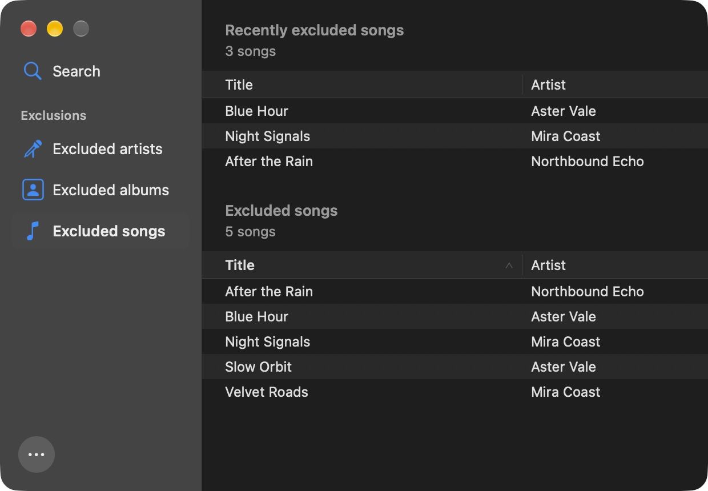

# Guide d’utilisation — Music Filter 1.0.0

[English](USER-GUIDE.md) · [Présentation du projet](../README.fr.md)

Music Filter accompagne **Musique sur Mac**. Vous choisissez les morceaux, albums ou artistes que vous ne souhaitez plus écouter ; le filtre les passe lorsqu’ils arrivent à la lecture. Vos exclusions sont conservées pour les prochaines écoutes.

**1.0.0** est la version de l’application. Seule l’option facultative **Filtrage anticipé (expérimental)** est expérimentale. Elle est expliquée dans la dernière section.

## 1. Installer et commencer

1. Dans **Releases**, téléchargez **Music-Filter-1.0.0.zip**. L’archive contenant `sources` dans son nom sert à consulter ou modifier le code, pas à installer l’application.
2. Décompressez le fichier, glissez **Music Filter.app** dans **Applications**, puis ouvrez-la.
3. Ouvrez Musique et lancez un morceau.
4. Lorsque macOS le demande, autorisez **Music Filter à contrôler Musique**. Cette autorisation d’**Automatisation** permet de connaître le morceau en cours et de le passer.

Cliquez sur l’icône associant une note et une main, dans la barre des menus en haut de l’écran. La fenêtre de gestion des exclusions n’a pas besoin de rester ouverte.

L’application cible macOS 14 ou ultérieur, sur Intel et Apple Silicon. Consultez [TESTING.md](../TESTING.md) pour connaître les essais réels et leurs limites.

Si vous avez refusé l’autorisation, activez le contrôle de Musique dans **Réglages Système → Confidentialité et sécurité → Automatisation**, puis quittez et relancez Music Filter. L’Accessibilité n’est pas nécessaire au filtrage habituel.

## 2. Ajouter une exclusion

Pendant la lecture, ouvrez le menu de Music Filter. Les trois premières actions indiquent les éléments détectés :

| Action | Portée |
| --- | --- |
| **Exclure le morceau** | Ce titre et cet artiste, sans exclure leurs autres morceaux. |
| **Exclure l’album** | Cet album et son artiste d’album, sans exclure les autres albums. |
| **Exclure l’artiste** | Cet artiste et ses collaborations identifiables dans les crédits de Musique. |

Cliquez sur votre choix. La règle est enregistrée ; si **Filtrage automatique** est actif, un morceau en cours qui lui correspond sera passé.

Les collaborations sont incluses automatiquement pour une exclusion d’artiste. Exclure un morceau ou un album n’exclut pas ses participants de leurs autres apparitions.

La reconnaissance utilise les noms et crédits fournis par Musique. Des crédits incomplets, un titre différent ou une autre édition peuvent ne pas correspondre. Si une action est grisée, vérifiez que Musique est ouverte et qu’un morceau avec ses informations est chargé.

## 3. Filtrage habituel et point rouge

Dans **Réglages**, la coche **Filtrage automatique** active le filtre. Décochez-la pour suspendre le filtrage sans effacer la liste. Cette suspension met aussi l’anticipation en pause.

Le filtrage habituel attend que Musique annonce le morceau en cours, puis le passe si une règle correspond. **Un bref début de son peut être audible.** Ce mode fonctionne avec la fenêtre de Musique fermée ou réduite, tant que l’application reste ouverte et poursuit sa lecture.

Un **point rouge pendant dix secondes** signale un saut réussi ou un retrait anticipé confirmé, pas simplement l’ajout d’une règle.

Faites un **clic droit sur l’icône** pour voir **Morceau exclu récemment**, avec l’artiste et le titre concernés. Cet événement reste affiché jusqu’au suivant pendant que Music Filter fonctionne. Il est réinitialisé après une relance : il ne s’agit pas d’un historique permanent. Sans événement, le menu indique **Aucune exclusion automatique récente**.

## 4. Gérer, rechercher et retirer des exclusions

**Gérer les exclusions** ouvre la catégorie **Morceaux exclus**. La barre latérale donne également accès aux **Artistes exclus** et **Albums exclus**.

*Capture réelle de l’interface anglaise, avec des noms fictifs de démonstration.*

**Morceaux exclus récemment** montre les **trois dernières règles de morceaux ajoutées**, ou moins si la liste est plus petite. **Morceaux exclus** affiche ensuite la liste complète et son nombre de morceaux. Ces ajouts récents sont distincts du dernier saut automatique consultable par clic droit sur l’icône. Les albums disposent aussi d’une section récente. Une pochette ou un portrait manquant n’empêche pas le filtrage.

Cliquez sur **Rechercher**, puis saisissez un titre, un artiste ou un album. La recherche concerne la **catégorie sélectionnée** ; changer de catégorie conserve votre recherche. Le bouton d’effacement réaffiche toute la liste. **Échap** ou un clic ailleurs ferme la bulle, mais conserve la recherche active.

Dans la liste complète des morceaux, cliquez sur **Titre** ou **Artiste** pour trier ; cliquez à nouveau pour inverser l’ordre. Les compteurs suivent les résultats. La section récente recherche seulement parmi les trois derniers ajouts : elle ne les remplace pas par des résultats plus anciens.

Pour autoriser de nouveau un élément, faites un clic droit dessus et choisissez **Retirer l’exclusion**. Une règle affichée dans deux sections reste une seule règle. Une autre exclusion peut encore s’appliquer : retirer un morceau ne suffit pas si son artiste ou son album reste exclu.

## 5. Sauvegarder, importer et tout supprimer

Ouvrez le bouton rond **…**, en bas à gauche de **Gérer les exclusions**.

**Exporter les exclusions…** ouvre une fenêtre pour choisir le dossier et le nom du fichier. Cliquez sur **Exporter** pour enregistrer un fichier **JSON** contenant tous les artistes, albums et morceaux exclus, avec leurs dates d’ajout. L’export couvre **toute la liste**, même pendant une recherche. Il permet de restaurer la liste après une réinstallation ou de la transférer sur un autre Mac. Les préférences, autorisations macOS et images ne sont pas incluses.

**Importer les exclusions…** permet de choisir un JSON précédemment exporté. L’import **fusionne** les listes : il ajoute les nouvelles règles, ignore les doublons et conserve vos exclusions actuelles. Un message indique le résultat. Un fichier invalide ou incompatible laisse la liste intacte.

**Supprimer toutes les exclusions…**, en rouge, demande une confirmation. **Annuler** est le choix par défaut ; **Tout supprimer** efface les règles de toutes les catégories, y compris les résultats masqués par une recherche. Aucun morceau n’est supprimé de votre bibliothèque Musique. Il n’y a pas de commande d’annulation : exportez d’abord si vous souhaitez pouvoir restaurer la liste.

## 6. Démarrage et relance

**Réglages → Démarrer avec Musique** est activé par défaut. Music Filter démarre discrètement à l’ouverture de votre session macOS, puis suit Musique : son icône apparaît lorsque Musique est ouverte et peut se masquer lorsque vous quittez Musique. Il ne lance pas Musique à votre place. Si macOS demande d’autoriser le démarrage en arrière-plan, suivez la demande dans Réglages Système.

Fermer **Gérer les exclusions** ou **À propos** ne quitte pas l’application. **Quitter Music Filter** l’arrête complètement, donc arrête le filtrage.

Pour la relancer, **ouvrez Music Filter depuis Applications ou Spotlight**. Aucun redémarrage du Mac ou de Musique n’est nécessaire. Un simple redémarrage de Musique ne doit pas être considéré comme une relance de Music Filter après l’avoir explicitement quittée.

## 7. Langue, données et mises à jour

L’interface est en **français si le français est la langue principale du Mac**, en **anglais pour toute autre langue principale**, même si le français figure ensuite dans les préférences. Le nom reste **Music Filter** et l’apparence claire ou sombre suit le système.

La liste est stockée localement dans `~/Library/Application Support/Music Filter/exclusions.json`, sans compte Music Filter ni serveur applicatif. Les pochettes et portraits peuvent être recherchés auprès des services publics d’Apple : ces requêtes transmettent les noms concernés et la région du Mac, sans cookie de connexion ni identifiant de compte. Les images sont mises en cache localement.

Le filtre concerne **ce Mac**, pas votre iPhone ni l’ensemble de votre compte Apple Music. Il ne supprime pas les éléments de votre bibliothèque.

Les mises à jour sont **manuelles** : quittez Music Filter, téléchargez la nouvelle version dans **Releases**, remplacez l’application dans **Applications**, puis ouvrez-la. Les exclusions et préférences sont conservées séparément ; un export préalable constitue une sauvegarde indépendante.

Signalez les problèmes dans **Issues**, avec les versions de Music Filter et de macOS, la langue et les étapes de reproduction. Retirez les informations personnelles des captures.

## 8. Filtrage anticipé (expérimental)

Cette option cherche à **retirer un morceau exclu de la file avant sa lecture**. Si le retrait réussit suffisamment tôt, le morceau ne démarre pas et son début n’est pas audible. Le résultat n’est cependant pas garanti à chaque transition.

### Pourquoi la fenêtre et la file doivent rester affichées

Le mode utilise les éléments que Musique expose par son interface d’**Accessibilité**. Il ne dispose pas d’une file complète indépendante de la fenêtre et ne parcourt pas une infinité de morceaux à venir.

Gardez **la fenêtre de Musique ouverte, non réduite dans le Dock, avec la file d’attente et ses prochains morceaux affichés**. Elle peut rester **derrière une autre application**. Fermer ou réduire cette fenêtre peut empêcher l’anticipation, même si la lecture continue. La fenêtre de gestion de Music Filter n’a pas besoin d’être visible.

Music Filter n’ouvre pas la file et ne la fait pas défiler à votre place. Seules les files de Musique en **français et en anglais** sont reconnues. L’interface anglaise de Music Filter sur un Mac dans une autre langue ne garantit pas la reconnaissance de la file de Musique dans cette langue.

### Activer et essayer

1. Lancez un morceau dans Musique et affichez la file d’attente.
2. Pour les suggestions de **Lecture automatique**, activez cette fonction dans Musique et affichez ses prochains morceaux. Pour une playlist en cours, affichez ses prochains morceaux ; Lecture automatique n’est pas nécessaire dans ce cas.
3. Dans les **Réglages** de Music Filter, gardez **Filtrage automatique** actif et activez **Filtrage anticipé (expérimental)**, désactivé par défaut.
4. Si **Autoriser l’accessibilité…** apparaît, utilisez cette commande puis autorisez Music Filter dans **Réglages Système → Confidentialité et sécurité → Accessibilité**. Cette permission supplémentaire sert à l’anticipation.
5. Observez un prochain morceau déjà concerné par une exclusion. Un retrait confirmé déclenche le point rouge et met à jour l’événement affiché par clic droit.

Une coche signifie que l’option est activée, pas qu’un retrait vient de réussir. L’absence de message est normale lorsque rien ne nécessite votre attention.

### Playlists, limites et messages

Le mode peut agir sur Lecture automatique et sur la file d’une playlist lancée, y compris recommandée. Il modifie **la file de lecture actuelle**, pas la playlist enregistrée, et ne parcourt pas toutes les playlists du catalogue.

Des informations manquantes, des changements de file ou le temps restant avant le prochain morceau peuvent empêcher le retrait. **Le saut habituel reste le recours** si Filtrage automatique est actif et l’Automatisation autorisée ; un bref début de son peut alors être entendu.

| Situation | Action |
| --- | --- |
| Fenêtre ou file non affichée | Restaurez la fenêtre, affichez la file et ses prochains morceaux. Elle peut ensuite rester en arrière-plan. |
| File indisponible avec nouvelle tentative annoncée | Laissez la file se stabiliser ; le filtre réessaie lorsque le message le précise. |
| **Retrait non confirmé** | Même si le morceau semble avoir disparu, le résultat n’a pas pu être vérifié. Vérifiez la file, puis désactivez et réactivez l’anticipation. |
| Pause après plusieurs retraits | Vérifiez la liste et la file, puis réactivez l’option comme indiqué. |
| Filtrage automatique suspendu après trop de morceaux exclus | Vérifiez vos exclusions, puis réactivez **Filtrage automatique**. |

Si l’anticipation gêne votre écoute, désactivez uniquement **Filtrage anticipé (expérimental)**. Vous pouvez continuer avec le filtrage habituel et conserver toutes vos exclusions.
