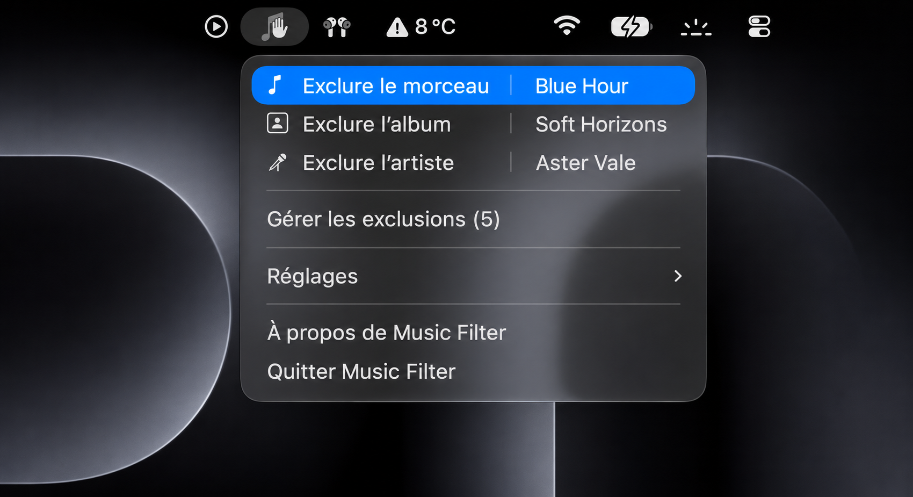
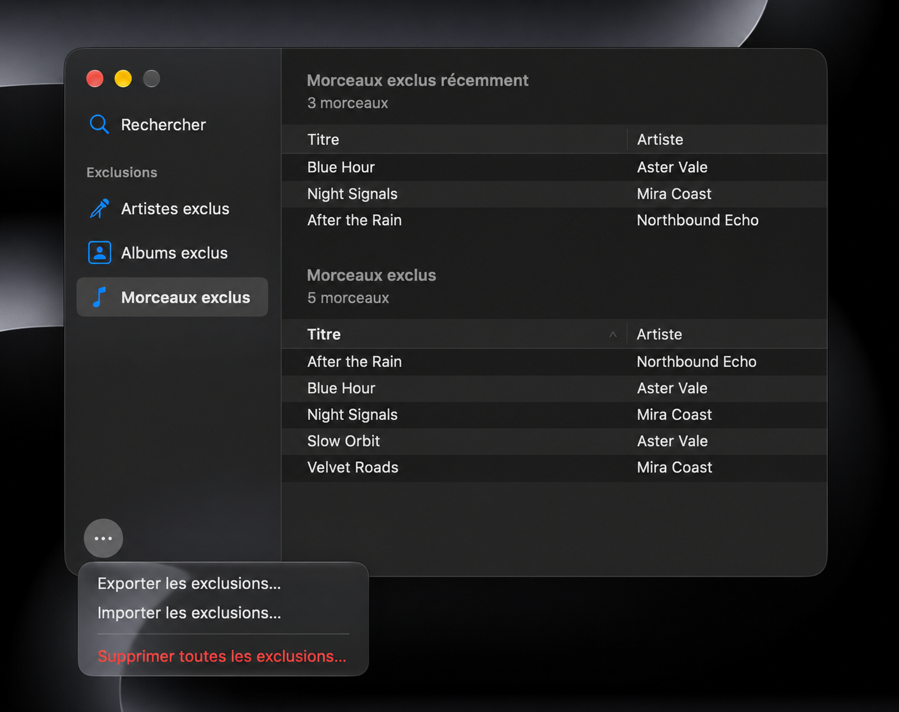
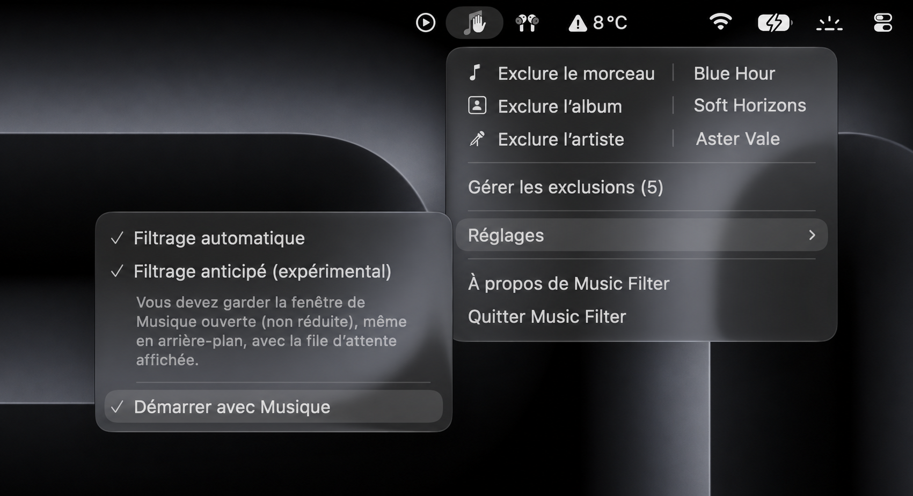
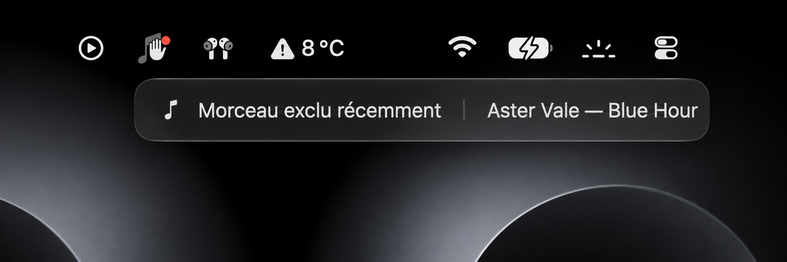

# Music Filter 1.0.0

**For serious listeners who want to exclude artists, albums and songs from Apple Music.**

Version **1.0.0 (build 62)** is the first release of Music Filter, an independent macOS companion for Apple Music, designed by **Antigone, a very small creative studio.**

Read the [user guide](USER-GUIDE.md) or the [French guide](GUIDE-UTILISATION.fr.md) for setup, backups and the experimental mode. Music Filter works with the Music app on macOS only.

## In pictures · En images

*Retouched demo illustrations with fictional data. French interface.*  
*Illustrations de démonstration retouchées, données fictives. Interface française.*

  

  

  

  

## What’s included

- Exclude songs, albums or artists from the menu bar. Artist exclusions automatically include recognized collaborations.
- Browse, search and sort your exclusion list, with the three most recently added songs shown separately.
- Export the complete list to JSON, import a backup without duplicates, or clear all exclusions after confirmation.
- See a ten-second indicator after a successful automatic exclusion and check the last excluded song with a right-click.
- Start with Music, follow system appearance, and use French or English automatically. French is selected only for a French primary system language; every other primary language uses English.

Normal filtering skips an excluded track as it starts; a brief sound can be audible. The optional **experimental** mode removes matching upcoming tracks from Music’s visible queue. It requires Automatic filtering to be enabled, Accessibility permission and an open, non-minimized Music window with the relevant queue displayed, even when Music is behind another app. Only French and English Music queue interfaces are supported. An uncertain removal can pause anticipation; saved playlists and the Music library are not edited.

## Download and install

Choose **Music-Filter-1.0.0.zip** in this release’s Assets for installation. Unzip it, drag **Music Filter.app** into **Applications**, then open it and allow control of Music. The archive includes English and French installation instructions.

Choose **Music-Filter-1.0.0-sources.zip** to inspect, build or modify the project. It is not the ready-to-install application. Each ZIP has an accompanying `.sha256` file for integrity verification. The source code is [MIT licensed](../LICENSE); third-party symbols, trademarks and artwork retain their own terms.

Music Filter targets macOS 14 or later and includes Intel and Apple Silicon architectures. There is no automatic updater: quit the app and replace it in Applications when installing a later release. Exclusions and preferences are stored separately; JSON export provides an independent backup.

## Verification and known limits

- 159 core tests passed, plus 22 isolated language-selection checks.
- Native deletion confirmation, cancellation and backup restoration were checked in an isolated fixture.
- The local update preserved saved exclusions and preferences.
- The distribution app is Developer ID signed and notarized by Apple. Notarization is a security check, not an App Store review or endorsement.
- Live checks cover macOS 27.2.1 on Apple Silicon. A clean Mac, Intel hardware and the minimum macOS version still need live testing.
- Exclusion matching depends on the names and credits Music provides. Missing or ambiguous collaboration credits can affect matching. Experimental queue filtering cannot guarantee silence before every excluded song.

See the [verification record](../TESTING.md). Report problems through the repository’s Issues tab, with your app and macOS versions, language, and reproduction steps. Remove personal information from screenshots and logs.

---

## Français

**Pour les passionnés de musique qui veulent exclure d’Apple Music les artistes, albums et morceaux qu’ils ne souhaitent plus écouter.**

Première version de Music Filter, une application macOS indépendante qui accompagne Musique, conçue par **Antigone, a very small creative studio.**

Consultez le [guide d’utilisation](GUIDE-UTILISATION.fr.md) pour la prise en main, les sauvegardes et le mode expérimental. Music Filter fonctionne uniquement avec l’application Musique sur macOS.

### Fonctionnalités

- Exclure un morceau, un album ou un artiste depuis la barre des menus. Les exclusions d’artistes incluent les collaborations identifiables.
- Parcourir, rechercher et trier les exclusions, avec les trois derniers morceaux ajoutés présentés séparément.
- Exporter toute la liste en JSON, importer une sauvegarde sans doublons ou supprimer toutes les exclusions après confirmation.
- Voir un indicateur pendant dix secondes après une exclusion automatique réussie et retrouver le dernier morceau exclu par clic droit.
- Démarrer avec Musique, suivre l’apparence du système et choisir automatiquement la langue : français uniquement si la langue principale du Mac est le français, anglais dans tous les autres cas.

Le filtrage normal passe un morceau exclu au début de sa lecture ; un bref son peut être audible. Le mode **expérimental**, facultatif, retire les prochains morceaux concernés de la file affichée dans Musique. Il nécessite le filtrage automatique actif, l’Accessibilité et une fenêtre de Musique ouverte, non réduite, avec la section concernée de la file affichée, même en arrière-plan. Seules les files de Musique en français et en anglais sont reconnues. Un retrait incertain peut mettre l’anticipation en pause ; les playlists enregistrées et la bibliothèque restent intactes.

### Télécharger et installer

Choisissez **Music-Filter-1.0.0.zip** dans les fichiers Assets de cette version. Décompressez-le, glissez **Music Filter.app** dans **Applications**, puis ouvrez-la et autorisez le contrôle de Musique. Les notices d’installation française et anglaise sont incluses.

**Music-Filter-1.0.0-sources.zip** permet de consulter, compiler ou modifier le projet. Cette archive ne contient pas l’application prête à installer. Chaque ZIP est accompagné d’un fichier `.sha256` permettant de vérifier son intégrité. Le code est sous [licence MIT](../LICENSE) ; les symboles, marques et images tierces conservent leurs conditions propres.

Music Filter cible macOS 14 ou ultérieur et contient les architectures Intel et Apple Silicon. Les mises à jour sont manuelles : quittez l’application puis remplacez-la dans Applications. Les exclusions et préférences sont stockées séparément ; l’export JSON fournit une sauvegarde indépendante.

### Vérifications et limites connues

- 159 tests du cœur et 22 vérifications isolées de sélection de langue ont réussi.
- La confirmation de suppression, l’annulation et la restauration d’une sauvegarde ont été vérifiées dans un jeu de données isolé.
- La mise à jour locale a conservé les exclusions et préférences.
- L’application de distribution est signée Developer ID et notarisée par Apple. La notarisation est un contrôle de sécurité, pas un examen App Store ni une recommandation d’Apple.
- Les essais réels portent sur macOS 27.2.1 et Apple Silicon. Un Mac vierge, le matériel Intel et la version minimale de macOS restent à tester.
- La reconnaissance dépend des noms et crédits fournis par Musique. Des collaborations mal ou incomplètement créditées peuvent échapper au filtrage. L’anticipation ne garantit pas une absence totale de son avant chaque morceau exclu.

Consultez [les vérifications](../TESTING.md). Signalez les problèmes dans l’onglet Issues du dépôt, en indiquant les versions de l’application et de macOS, la langue et les étapes de reproduction. Retirez les informations personnelles des captures et journaux.
