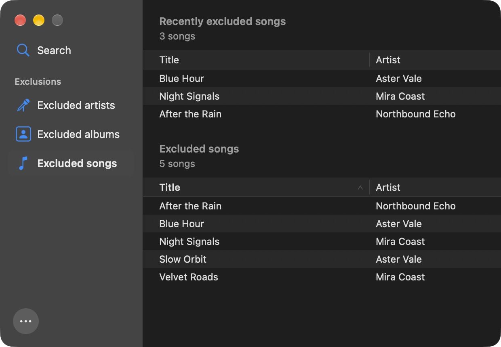

# User guide — Music Filter 1.0.0

[Français](GUIDE-UTILISATION.fr.md) · [Project overview](../README.md)

Music Filter works alongside **Music on your Mac**. Choose the songs, albums or artists you do not want to hear, and the filter skips them when they reach playback. Your exclusions stay saved for future listening.

**1.0.0** is the application release. Only the optional **Filter upcoming songs (experimental)** feature is experimental. It is explained in the final section.

## 1. Install and get started

1. From **Releases**, download **Music-Filter-1.0.0.zip**. The archive with `sources` in its name is for reading or modifying the code, not installing the app.
2. Unzip it, drag **Music Filter.app** into **Applications**, then open it.
3. Open Music and play a song.
4. When macOS asks, allow **Music Filter to control Music**. This **Automation** permission lets the app identify and skip the current song.

Click the musical note and hand icon in the menu bar at the top of your screen. The exclusions management window does not need to stay open.

The app targets macOS 14 or later, on Intel and Apple Silicon. See [TESTING.md](../TESTING.md) for live testing coverage and its limits.

If you previously denied permission, allow control of Music in **System Settings → Privacy & Security → Automation**, then quit and reopen Music Filter. Accessibility is not needed for regular filtering.

## 2. Add an exclusion

During playback, open Music Filter’s menu. The first three actions show the detected song, album and artist:

| Action | Scope |
| --- | --- |
| **Exclude song** | This title by this artist, without excluding their other songs. |
| **Exclude album** | This album and its album artist, without excluding other albums. |
| **Exclude artist** | This artist and identifiable collaborations in Music’s credits. |

Click your choice. The rule is saved; if **Automatic filtering** is enabled, a currently playing song that matches it will be skipped.

Collaborations are automatically included for artist exclusions. Excluding a song or album does not exclude its participants from their other work.

Matching uses Music’s names and credits. Incomplete credits, different titles or another edition may not match. If an action is unavailable, check that Music is open and a song with its details is loaded.

## 3. Regular filtering and the red dot

In **Settings**, the **Automatic filtering** checkmark enables filtering. Turn it off to pause without erasing the list. This also pauses upcoming-song filtering.

Regular filtering waits for Music to announce the current song, then skips it if a rule matches. **A brief start of the song can be audible.** It can work with Music’s window closed or minimized, provided the application remains running and playing.

A **red dot for ten seconds** indicates a successful skip or confirmed upcoming removal, not simply a new rule.

**Right-click the icon** to see **Recently excluded song**, with its artist and title. This event remains until the next automatic exclusion while Music Filter is running. It resets when you restart the app; it is not a permanent history. Without an event, the menu says **No recent automatic exclusions**.

## 4. Manage, search and remove exclusions

**Manage exclusions** opens **Excluded songs**. The sidebar also offers **Excluded artists** and **Excluded albums**.

*Actual interface screenshot with fictional demonstration names.*

**Recently excluded songs** shows the **three song rules most recently added**, or fewer if your list is smaller. **Excluded songs** then shows the full list and its count. These additions are distinct from the last automatic skip available through the icon’s right-click menu. Albums also have a recent section. Missing artwork does not prevent filtering.

Click **Search** and enter a title, artist or album. Search filters the **selected category**; switching categories preserves your query. The clear button restores the full list. **Escape** or a click outside closes the bubble but leaves the search active.

In the full song list, click **Title** or **Artist** to sort; click again to reverse the order. Counts follow the results. The recent section searches only the latest three additions, without replacing them with older matches.

To allow an item again, right-click it and choose **Remove exclusion**. A rule shown in two sections remains one rule. Another exclusion may still apply: removing a song rule is not enough if its artist or album remains excluded.

## 5. Back up, import and clear the list

Open the round **…** button at the bottom-left of **Manage exclusions**.

**Export exclusions…** opens a dialog to choose a folder and filename. Click **Export** to save a **JSON** file containing all excluded artists, albums and songs, with their addition dates. Export includes **the entire list**, even during a search. Use it to restore your list after reinstalling or transfer it to another Mac. Preferences, macOS permissions and images are not included.

**Import exclusions…** lets you select a previously exported JSON file. Import **merges** the lists: it adds new rules, ignores duplicates and keeps your current exclusions. A message reports the result. An invalid or unsupported file leaves the list unchanged.

The red **Delete all exclusions…** command asks for confirmation. **Cancel** is the default; **Delete all** clears rules in every category, including results hidden by a search. No songs are deleted from your Music library. There is no undo command: export first if you want to restore the list later.

## 6. Startup and reopening

**Settings → Start with Music** is on by default. Music Filter starts quietly when you log in to macOS, then follows Music: its icon appears when Music is open and can hide when you quit Music. It does not launch Music for you. If macOS asks you to approve background startup, follow the request in System Settings.

Closing **Manage exclusions** or **About** does not quit the app. **Quit Music Filter** stops it completely, including filtering.

To restart it, **open Music Filter from Applications or Spotlight**. You do not need to restart your Mac or Music. Do not rely on restarting Music alone to relaunch Music Filter after explicitly quitting it.

## 7. Language, data and updates

The interface uses **French when French is your Mac’s primary language**, and **English for every other primary language**, even if French is a secondary preference. The name remains **Music Filter**, and light or dark appearance follows the system.

Your list is stored locally at `~/Library/Application Support/Music Filter/exclusions.json`, without a Music Filter account or application server. Artwork can be requested from Apple’s public services: these requests send the relevant artist or album names and your Mac’s region, without account cookies or credentials. Images are cached locally.

Filtering affects **this Mac**, not your iPhone or your entire Apple Music account. It does not remove items from your library.

Updates are **manual**: quit Music Filter, download the new release from **Releases**, replace the app in **Applications**, then open it. Exclusions and preferences are stored separately; exporting first provides an independent backup.

Report problems in **Issues**, including Music Filter and macOS versions, language and reproduction steps. Remove personal information from screenshots.

## 8. Filter upcoming songs (experimental)

This option tries to **remove an excluded song from the queue before playback**. If removal succeeds early enough, the song never starts and its opening is not heard. Success is not guaranteed at every transition.

### Why the window and queue must stay displayed

The feature uses elements Music exposes through its **Accessibility interface**. It does not have a complete queue independent of the window and cannot inspect unlimited future songs.

Keep **Music’s window open, not minimized to the Dock, with the queue and its upcoming songs displayed**. It can remain **behind another application**. Closing or minimizing the window can prevent anticipation even while playback continues. Music Filter’s management window does not need to be visible.

Music Filter does not open or scroll the queue for you. Only Music’s **French and English** queue interfaces are recognized. Music Filter using its English fallback on a Mac set to another language does not guarantee recognition of Music’s queue in that language.

### Enable and try it

1. Play a song in Music and display the queue.
2. For **AutoPlay** suggestions, enable AutoPlay in Music and show its upcoming songs. For a playing playlist, show its upcoming songs; AutoPlay is not required in that case.
3. In Music Filter’s **Settings**, keep **Automatic filtering** on and enable **Filter upcoming songs (experimental)**, which is off by default.
4. If **Allow Accessibility…** appears, use it and allow Music Filter in **System Settings → Privacy & Security → Accessibility**. This additional permission is for upcoming filtering.
5. Watch an upcoming song already covered by an exclusion. A confirmed removal triggers the red dot and updates the event shown by right-clicking the icon.

A checkmark means the option is enabled, not that a removal just succeeded. No message is normal when nothing needs your attention.

### Playlists, limits and messages

The mode can act on AutoPlay and the queue of a playing playlist, including a recommended playlist. It changes **the current playback queue**, not the saved playlist, and does not inspect every playlist in the catalog.

Missing information, queue changes or the time before the next song can prevent removal. **Regular skipping remains the fallback** when Automatic filtering is enabled and Automation is authorized; a brief opening can then be audible.

| Situation | What to do |
| --- | --- |
| Window or queue not displayed | Restore Music’s window and show the queue and upcoming songs. It can then remain in the background. |
| Queue unavailable with an automatic retry announced | Let the queue settle; the filter retries when the message says it will. |
| **Unconfirmed removal** | Even if the song seems to have disappeared, the result could not be verified. Check the queue, then turn upcoming filtering off and on. |
| Pause after repeated removals | Check the list and queue, then re-enable the option as instructed. |
| Automatic filtering paused after too many excluded songs | Review your exclusions, then turn **Automatic filtering** back on. |

If anticipation disrupts your listening, turn off only **Filter upcoming songs (experimental)**. You can keep regular filtering and all your saved exclusions.
