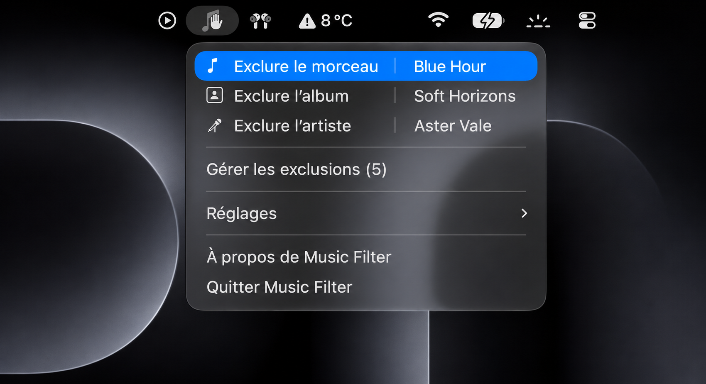
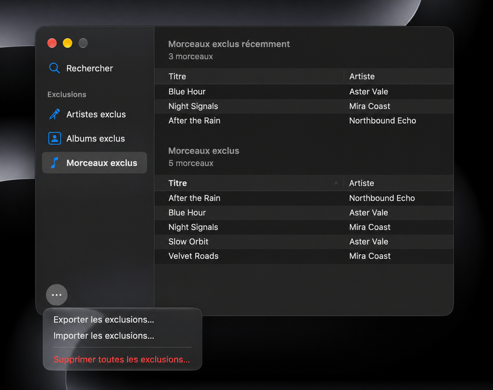
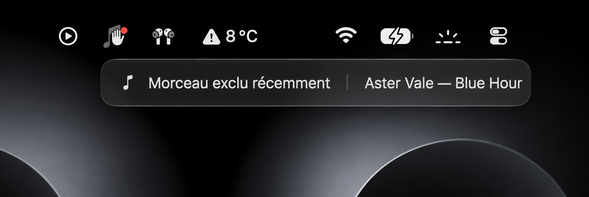
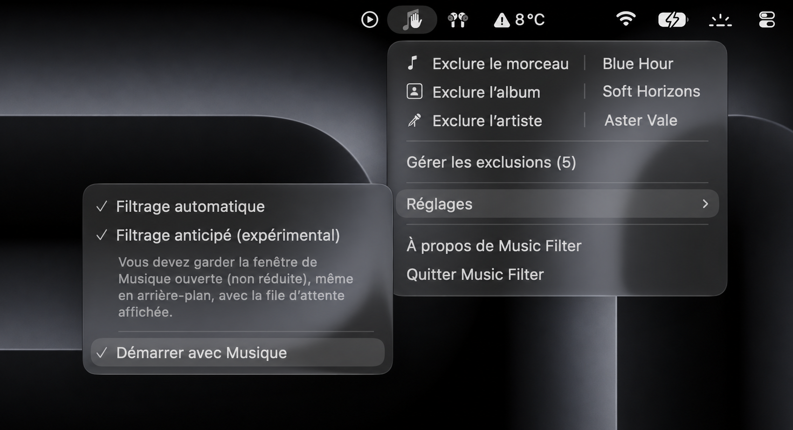

# Music Filter

[English](README.md) · [Guide d’utilisation](Docs/GUIDE-UTILISATION.fr.md) · [Version 1.0.0](Docs/RELEASE-v1.0.0.md)

**Pour les passionnés de musique qui veulent exclure d’Apple Music les artistes, albums et morceaux qu’ils ne souhaitent plus écouter.**

Les recommandations d’Apple Music peuvent faire revenir des morceaux ou artistes que vous ne souhaitez pas écouter. Music Filter ajoute une **liste personnelle d’exclusions à Musique sur votre Mac** et passe automatiquement les morceaux, albums et artistes choisis, depuis la barre des menus.

Conçue par **Antigone, a very small creative studio.**

<p align="center">
  
</p>

*Illustrations de démonstration retouchées, données fictives. Interface française.*

## Gardez la main sur vos écoutes

- **Exclure un morceau, un album ou un artiste** depuis la barre des menus pendant la lecture. Les exclusions d’artistes incluent les collaborations identifiables ; celles des morceaux et albums gardent leur propre périmètre.
- **Gérer votre liste** avec la recherche, le tri et les ajouts récents. Un clic droit permet de retirer une exclusion.
- **Conserver votre sauvegarde.** Exporter et importer toutes les exclusions dans un fichier JSON local, sans compte ni serveur.
- **Voir ce qui s’est passé.** Un point rouge apparaît pendant dix secondes après une exclusion automatique réussie. Un clic droit sur l’icône affiche le dernier morceau exclu, avec son artiste.
- **Profiter du français ou de l’anglais automatiquement**, avec une apparence claire ou sombre qui suit le Mac.

<p align="center">
  
</p>

<p align="center">
  
</p>

[Captures originales de l’interface anglaise](Docs/Images/README.md)

## Installer et commencer

Utilisez **Music-Filter-1.0.0.zip**, le paquet prêt à installer décrit dans les [notes de version](Docs/RELEASE-v1.0.0.md). L’archive de sources distincte sert à compiler ou modifier le projet.

1. Décompressez le paquet, glissez **Music Filter.app** dans **Applications**, puis ouvrez-la.
2. Autorisez Music Filter à contrôler **Musique** lorsque macOS le demande.
3. Lancez une lecture dans Musique, cliquez sur la main et la note dans la barre des menus, puis choisissez ce que vous souhaitez exclure.

L’application universelle cible **macOS 14 ou ultérieur**, sur Intel et Apple Silicon. Les essais réels portent actuellement sur macOS 27.2.1 et Apple Silicon ; une installation sur un Mac vierge, le matériel Intel et la version minimale de macOS restent à tester. L’application de distribution est signée Developer ID et notarisée. La notarisation est un contrôle de sécurité d’Apple, pas un examen App Store ni une recommandation d’Apple. Consultez [les vérifications](TESTING.md).

Le français est utilisé uniquement si le français est la langue principale du Mac. Toute autre langue principale sélectionne l’anglais, même avec le français en préférence secondaire. Le nom **Music Filter** reste identique dans les deux langues.

**Démarrer avec Musique** est activé par défaut : l’application démarre discrètement à la connexion et affiche son icône lorsque Musique est ouverte. Quitter arrête complètement l’application ; ouvrez-la à nouveau depuis Applications pour la relancer. macOS peut demander d’autoriser son lancement en arrière-plan.

## Filtrage quotidien et anticipation avancée

**Filtrage automatique** passe un morceau exclu lorsque Musique le signale comme morceau en cours. Un bref début de son peut être audible. Il nécessite l’autorisation **Automatisation**.

**Filtrage anticipé (expérimental)** peut retirer les prochains morceaux concernés de la file avant leur lecture. Désactivé par défaut, il nécessite le **Filtrage automatique** actif et l’autorisation **Accessibilité**. La fenêtre de Musique doit rester ouverte, non réduite, avec la section concernée de la file affichée ; elle peut être derrière une autre application. Ce mode reconnaît les files de Musique en français et en anglais, notamment la lecture automatique et les prochains morceaux d’une playlist en cours.

Des métadonnées manquantes empêchent le retrait ; un retrait non confirmé peut mettre l’anticipation en pause. Le filtrage normal reste disponible. L’absence totale de son avant chaque morceau exclu n’est pas garantie. La reconnaissance dépend des noms et crédits fournis par Musique, notamment ceux des collaborations.

Music Filter fonctionne exclusivement avec Musique sur macOS. Il ne contrôle ni la lecture sur iPhone ou sur le web, ni les autres services de streaming. Vos exclusions restent sur ce Mac et ne sont pas synchronisées avec votre compte Apple Music. L’application agit sur la lecture et, en option, sur la file à venir, sans modifier votre bibliothèque ni vos playlists enregistrées. Le [guide d’utilisation](Docs/GUIDE-UTILISATION.fr.md) détaille les autorisations, l’usage quotidien et le filtrage expérimental.

<p align="center">
  
</p>

## Votre liste, vos données

Dans **Gérer les exclusions**, le menu **…** en bas à gauche propose **Exporter les exclusions…**, **Importer les exclusions…** et **Supprimer toutes les exclusions…**. L’export sauvegarde toute la liste, même pendant une recherche. L’import fusionne les entrées sans doublons. La suppression demande une confirmation, avec Annuler sélectionné par défaut, et concerne toutes les catégories. Elle ne supprime aucun morceau de Musique. Les préférences et autorisations macOS ne sont pas incluses dans la sauvegarde.

Les exclusions restent dans `~/Library/Application Support/Music Filter/exclusions.json`. Le projet n’ajoute ni compte, ni serveur applicatif, ni analyse d’usage. L’affichage des images peut transmettre les noms d’artistes, d’albums et la région du Mac aux services publics d’Apple ; les images sont téléchargées sans identifiant de compte et mises en cache localement.

Les mises à jour sont **manuelles** : quittez l’application et remplacez-la dans Applications. Les exclusions et préférences sont conservées séparément. Aucun système de mise à jour automatique n’est encore intégré.

## Compiler et contribuer

La compilation nécessite **Xcode 27 ou ultérieur** et ses outils de ligne de commande :

```sh
./Scripts/build.sh
swift test
```

Le résultat est `build/Build/Products/Release/Music Filter.app`. Vous pouvez aussi ouvrir `FiltreMusique.xcodeproj` avec son schéma `FiltreMusique`. La compilation locale utilise une signature ad hoc ; une distribution nécessite vos propres identifiants.

Signalez les problèmes dans l’onglet Issues du dépôt, avec les versions de macOS et de l’application, la langue et les étapes de reproduction. Retirez les informations personnelles des captures et journaux. Les contributions et signalements en français sont bienvenus : [contribuer](CONTRIBUTING.md) · [vérifications et limites](TESTING.md) · [distribution](Docs/DISTRIBUTION.md).

## Licence

Code source : [MIT](LICENSE). Les symboles Apple, marques et images conservent leurs conditions propres ; consultez [les notices tierces](THIRD_PARTY_NOTICES.md). Music Filter est indépendant, non affilié à Apple et non recommandé par Apple.
