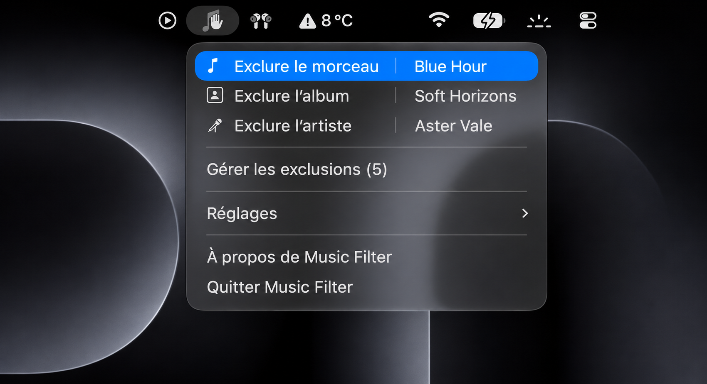
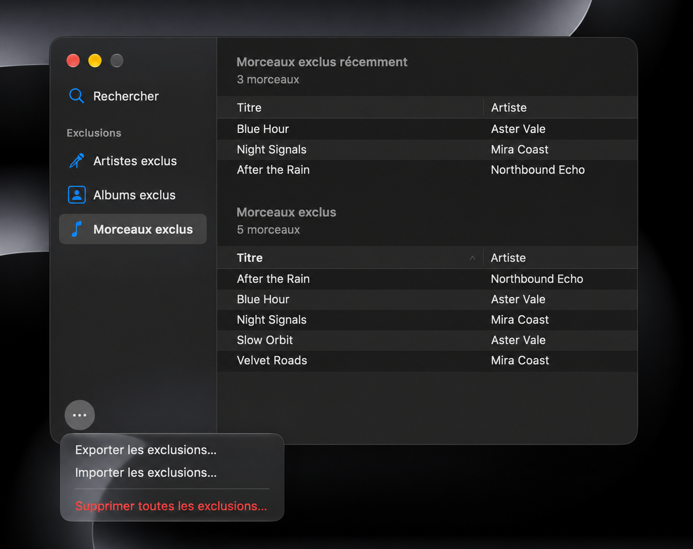
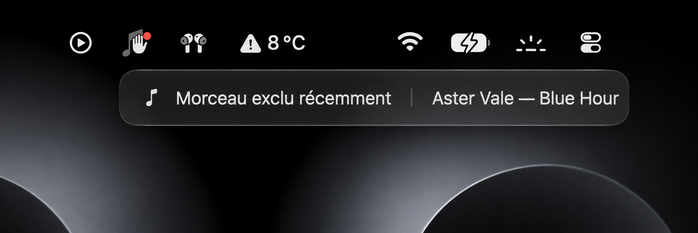
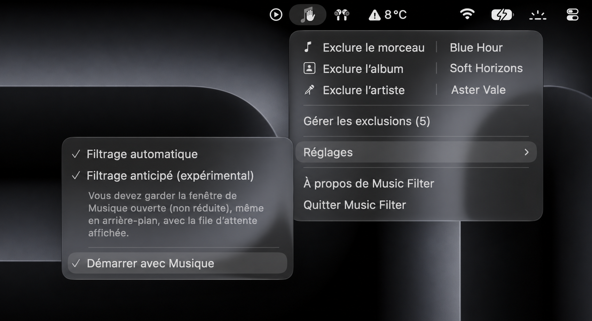

# Music Filter

[Français](README.fr.md) · [User guide](Docs/USER-GUIDE.md) · [Version 1.0.0](Docs/RELEASE-v1.0.0.md)

**For serious listeners who want to exclude artists, albums and songs from Apple Music.**

Apple Music recommendations can bring back songs or artists you would rather not hear. Music Filter adds a **personal exclusion list to Apple Music on your Mac**, automatically skipping the songs, albums and artists you choose. Its controls stay in the menu bar.

Designed by **Antigone, a very small creative studio.**

<p align="center">
  
</p>

*Retouched demo illustrations with fictional data. French interface.*

## Keep your listening yours

- **Exclude a song, album or artist** from the menu bar while Music is playing. Artist exclusions also include recognized collaborations; song and album rules keep their own scope.
- **Manage your list** with search, sorting and recent additions. Right-click an entry to allow it again.
- **Keep your own backup.** Export and import every exclusion in a local JSON file, without an account or server.
- **See what happened.** A red indicator appears for ten seconds after a successful automatic exclusion. Right-click the menu bar icon to see the last excluded song and its artist.
- **Use French or English automatically**, with light and dark appearance following your Mac.

<p align="center">
  
</p>

<p align="center">
  
</p>

[Original English interface captures](Docs/Images/README.md)

## Install and get started

Use **Music-Filter-1.0.0.zip**, the ready-to-install package described in the [release notes](Docs/RELEASE-v1.0.0.md). The separate source archive is for building or modifying the project.

1. Unzip the application package, drag **Music Filter.app** into **Applications**, and open it.
2. Allow Music Filter to control **Music** when macOS asks.
3. Play something in Music, click the hand-and-note icon in the menu bar, and choose what to exclude.

The universal app targets **macOS 14 or later**, on Intel and Apple Silicon. Live checks currently cover macOS 27.2.1 on Apple Silicon; clean-Mac installation, Intel hardware and the minimum macOS version remain untested. The distribution app is Developer ID signed and notarized. Notarization is Apple’s security check, not an App Store review or endorsement. See [verification details](TESTING.md).

French is used only when French is the Mac’s primary language. Every other primary language uses English, even with French as a secondary preference. The name **Music Filter** is the same in both languages.

**Start with Music** is enabled by default: it starts the app silently at login and shows its icon when Music is open. Quitting exits the app completely; reopen it from Applications to restart it. macOS may require approval for background startup.

## Everyday filtering and advanced anticipation

**Automatic filtering** skips an excluded track once Music reports it as the current song. A brief start of the track can be audible. It requires **Automation** permission.

**Filter upcoming songs (experimental)** can remove matching tracks from the upcoming queue before playback. It is off by default and requires both **Automatic filtering** and **Accessibility** permission. Music’s window must be open, not minimized, with the relevant queue section displayed; it may remain behind another app. This mode recognizes French and English Music queue interfaces, including AutoPlay and upcoming tracks from a playing playlist.

Missing metadata prevents removal; an unconfirmed removal can pause anticipation. Normal filtering remains available. There is no guarantee of silence before every excluded song. Matching depends on the names and credits Music supplies, including collaboration credits.

Music Filter works exclusively with the macOS Music app. It does not control iPhone or web playback, or other streaming services. Your exclusion rules stay on this Mac and are not synced to your Apple Music account. The app changes playback and, optionally, the upcoming queue, without editing your library or saved playlists. See the [user guide](Docs/USER-GUIDE.md) for permissions, daily use and experimental filtering.

<p align="center">
  
</p>

## Your list, your data

In **Manage exclusions**, the bottom-left **…** menu provides **Export exclusions…**, **Import exclusions…** and **Delete all exclusions…**. Export saves the whole list, even during a search. Import merges entries without duplicates. Clearing requires confirmation, with Cancel selected by default, and affects every exclusion category. It never deletes tracks from Music. Preferences and macOS permissions are not part of the backup.

Exclusions stay at `~/Library/Application Support/Music Filter/exclusions.json`. The project has no accounts, application server or analytics. Displaying artwork can send artist names, album names and your Mac’s region to Apple’s public services; images are downloaded without account credentials and cached locally.

Updates are **manual**: quit the app and replace it in Applications. Exclusions and preferences are stored separately. There is no automatic updater yet.

## Build and contribute

Building requires **Xcode 27 or later** and its command-line tools:

```sh
./Scripts/build.sh
swift test
```

The result is `build/Build/Products/Release/Music Filter.app`. Alternatively, open `FiltreMusique.xcodeproj` with its `FiltreMusique` scheme. Local builds use ad hoc signing; distribution requires your own credentials.

Report problems through the repository’s Issues tab with your macOS and app versions, language and reproduction steps. Remove personal information from screenshots and logs. Contributions and French reports are welcome: [contribution guide](CONTRIBUTING.md) · [tests and limits](TESTING.md) · [distribution](Docs/DISTRIBUTION.md).

## License

Source code: [MIT](LICENSE). Apple symbols, trademarks and artwork retain their own terms; see [third-party notices](THIRD_PARTY_NOTICES.md). Music Filter is independent and is not affiliated with or endorsed by Apple.
